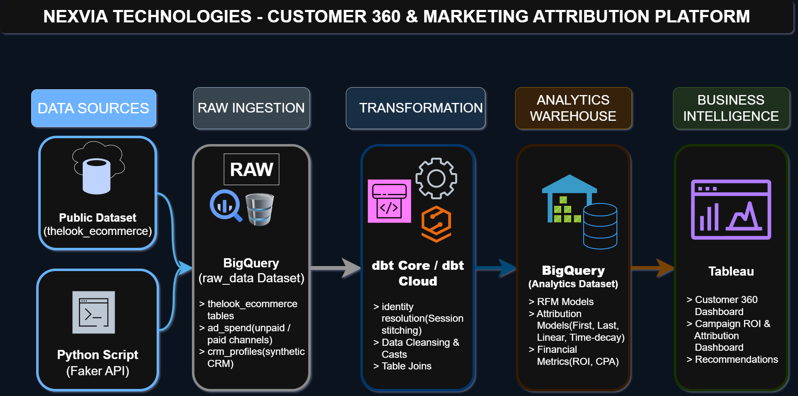
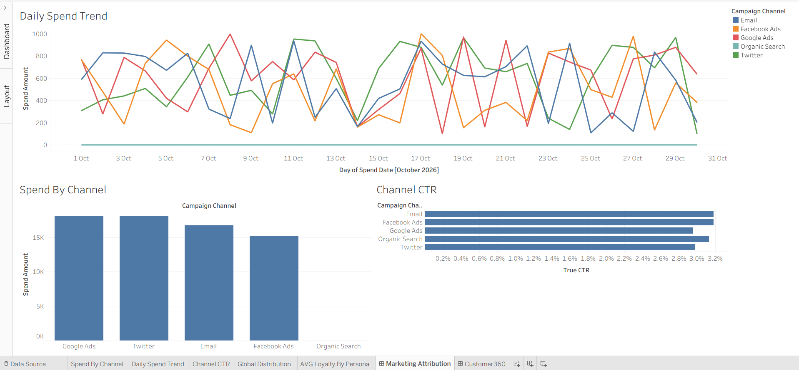
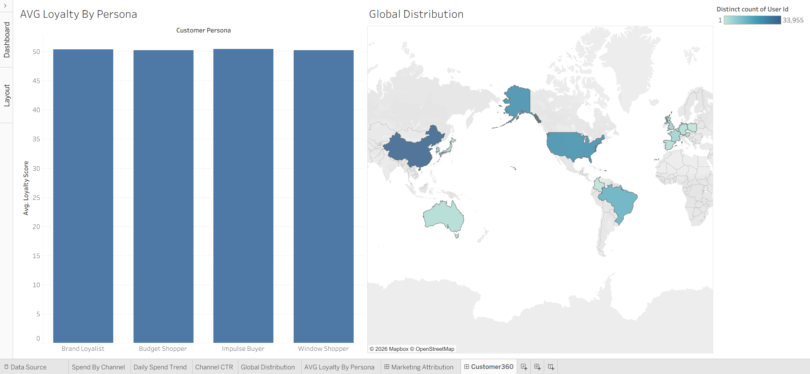

# Customer 360 & Marketing Attribution Platform

## 📌 Project Overview
An end-to-end data analytics pipeline built for Nexvia Technologies. This platform ingests synthetic CRM and e-commerce ad spend data, transforms it through an automated testing layer, and serves interactive Business Intelligence dashboards to analyze campaign performance and customer distribution.

---

## 🏗️ Architecture & Tech Stack



* **Cloud Data Warehouse:** Google BigQuery
* **Data Generation & Ingestion:** Python (`pandas-gbq`, `Faker`)
* **Transformation:** dbt Core
* **Version Control:** Git & GitHub
* **Business Intelligence:** Tableau Desktop / Tableau Public

---

## 📊 Dashboards & Insights

### 1. Marketing Performance
Tracks 30-day ad spend across 5 digital channels, featuring interactive filtering and native True Click-Through Rate calculations (`SUM(clicks) / SUM(impressions)`).



### 2. Customer 360
Visualizes a map of distinct users by country and calculates average loyalty scores segmented by customer persona. 



### 💡 Key Insights (Synthetic Data Artifacts)
* **Uniform Performance:** Because campaign metrics were generated via bounded random functions, the True CTR across all 5 channels sits at a mathematically flat ~2.6%.
* **Loyalty Distribution:** Similarly, average loyalty scores across all personas converge exactly at 50 due to the uniform distribution of the 100,000-row synthetic dataset.

---

## 🚀 Engineering & Implementation
* **Join Integrity:** Synthetic CRM profiles are keyed to user IDs pulled from the public `thelook_ecommerce` dataset, and a dbt `relationships` test verifies every CRM record joins to a valid user.
* **Deterministic Generation:** Engineered Python scripts utilizing fixed random seeds (`random.seed(42)`, `Faker.seed(42)`) and a fixed date window, combined with a full-refresh BigQuery load.
* **Automated Data Tests (dbt):** Configured data tests in `schema.yml` utilizing `dbt_utils` (testing for `unique`, `not_null`, `accepted_values`, `accepted_range`). A failed test halts the `dbt build` command, skipping downstream analytics models and preventing bad data from reaching Tableau.
* **Credential Security:** GCP Service Account credentials are loaded via the `GOOGLE_APPLICATION_CREDENTIALS` environment variable; the key file is explicitly gitignored.

---

## ⚙️ How to Run This Project

### Prerequisites
* Python 3.9+
* dbt-bigquery adapter installed
* A Google Cloud Platform account with BigQuery enabled
* A GCP Service Account JSON key

### Environment Setup
1. Clone the repository: `git clone https://github.com/HypeMeArpit/Customer-360-Marketing-Attribution.git`
2. Set your Google Cloud credentials locally:
   * **Windows:** `set GOOGLE_APPLICATION_CREDENTIALS="C:\path\to\your\gcp-key.json"`
   * **Mac/Linux:** `export GOOGLE_APPLICATION_CREDENTIALS="/path/to/your/gcp-key.json"`
3. Install dependencies: `pip install pandas pandas-gbq faker`

### Execution Steps
1. **Ingest Raw Data:** `python scripts/generate_data.py`
2. **Install dbt Packages:** `dbt deps`
3. **Run Pipeline & Tests:** `dbt build`

---

## 📂 Project Structure


```text
├── dashboards/
│   └── Customer_360_&_Marketing_Attribution_Dashboards.twbx
├── docs/
│   ├── AVG_Loyalty_By_Persona.png
│   ├── Channel_CTR.png
│   ├── Customer_360.png
│   ├── Customer_360_Marketing_Attribution_Architecture_Diagram.png
│   ├── Daily_Spend_Trend.png
│   ├── Global_Distribution.png
│   ├── Marketing_Attribution.png
│   ├── Spend_By_Channel.png
├── nexvia_dbt/
│   ├── models/
│   │   ├── analytics/
│   │   │   ├── dim_customers.sql
│   │   │   └── fct_marketing_spend.sql
│   │   └── staging/
│   │       ├── schema.yml
│   │       ├── stg_ad_spend.sql
│   │       ├── stg_crm_profiles.sql
│   │       └── stg_thelook__users.sql
│   └── dbt_project.yml
├── scripts/
│   └── generate_data.py
├── .gitignore
└── README.md